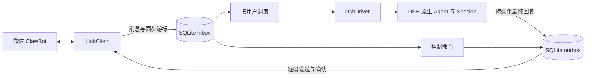

# 微信文字通道架构

插件为 DSH 提供一个单账号、多个可信私聊用户的文字通道。DSH 负责 Agent、模型、工具、权限、工作区与 Session 日志；插件负责微信身份、入站接收、调度、回复投递和本机连接生命周期。插件不实现第二套 Agent 循环，也不重新定义 DSH 的模型或工具权限。

## 组件和数据流

| 模块 | 拥有的职责 |
| --- | --- |
| `index.ts` | Cordis 服务依赖和一个可等待的账号 effect；不关闭数据库或 Agent。 |
| `config.ts` | 配置解析、默认值、有效路径和可信 API 主机限制。 |
| `runtime.ts` | 账号锁、凭据、SQLite、Driver 的唯一资源所有者；处理启动失败和有序清理。 |
| `protocol.ts` | iLink HTTP 字段、整数 ID、鉴权、响应校验、输入状态和网络失败分类。 |
| `commands.ts` | 命令名称与说明，供入站分类、微信帮助和模型渠道说明共用。 |
| `engine.ts` | 接收、命令、用户任务与投递的协调器；拥有运行中的异步操作。 |
| `store.ts` | 入站事务、收件箱、会话映射、命令记录、分段 outbox 和版本迁移。 |
| `driver.ts` | 创建或恢复插件拥有的 Agent，挂载原生预设和权限，等待工作停稳并 flush。 |
| `activity.ts` | 单次任务的原生“正在输入”状态；不决定任务或回复是否成功。 |
| `delivery.ts` | 无损 Unicode 分段及段号标签。 |
| `wakeup.ts` | 实例内通知；空闲任务和投递器不靠定时扫描数据库唤醒。 |

## 接收和授权

账号身份来自用户扫码确认后的 `ilink_user_id`，不会把“第一个来发消息的人”当作账号主人。空 `allowedUsers` 表示只授权扫码用户；非空列表完全替换这个默认值。群聊与 bot 消息被忽略，未经授权的私聊既不创建任务，也不获得回复。

有效消息及其下一次同步游标在同一个 SQLite 事务中提交。ID 从 JSON 数字原文无损读取；去重与游标推进使用同一数据库，不存在先标记已读、后保存任务的时间窗口。格式错误使整批事务失败，游标不前移，连接明确停止并报告。

`maxPendingMessages` 限制已接纳的模型任务数量。达到容量时，新任务被保存为明确的拒绝通知，不交给模型；轮询继续接收 `/status`、`/stop` 等命令。发送者收到“稍后重发”，而不是一个实际没有排队的成功提示。

## 调度与会话

每个用户最多有一个正在运行的任务，同一用户按入站顺序执行；不同用户可在 `maxConcurrentUsers` 范围内并行。单独的控制命令处理不占模型执行槽，因此 `/help` 和 `/status` 不必等前一个模型任务结束。状态计数只显示请求用户自己的任务。

`/stop` 和 `/new` 在入站事务里取消同一用户此前尚未开始的任务，不取消命令之后到达的消息。`/stop` 只对当前运行任务发出一次取消；不存在稍后再次消费命令、误伤后续任务的第二入口。

`/new` 在取消后等待旧任务及其清理完成，再释放旧 Agent、清除该用户的会话映射。后来的任务被阻挡在这次切换之后，其他控制命令仍能响应。取消或失败可能已经产生文件、命令等操作结果，通知明确说明不会撤销这些结果。

微信用户映射到插件创建的独立 DSH Session；插件不会借用其他消费者拥有的 live Agent。Agent 的具体行为来自原生预设，审批策略固定为 `never`，默认权限预设为 `read-only`。微信帮助和模型看到的渠道说明由同一命令表生成；渠道说明通过 Agent 作用域的 `systemPrompt.section` 进入正常的系统消息持久化流程。

本地控制命令的收件记录保存在 SQLite；这不等于把全部历史命令注入模型上下文。模型知道当前通道及命令用途，不会凭空获得未记录的用户操作历史。

## 回复和投递

插件等待根 Agent 与子 Agent 工作停稳，再 flush Session，保存完整最终回复。回复超过 `maxReplyChars` 时切成带 `[i/n]` 标签的段，标签计入段长；不会截断正文，也不会切坏 Unicode 码点。

每段有固定的 `client_id` 和独立状态：`pending → sending → done`。只有收到 iLink 的有效成功响应才确认该段，已确认的前缀不再重发。发送器在一个账号内串行发送，并以 `outboundIntervalMs` 间隔避免连续突发。输入状态通过独立的 `getconfig` / `sendtyping` 接口表达，不额外发送进度文字。

网络失败、缺失确认或中途退出使正在投递的段成为 `unknown`，同一回复的剩余段暂停。iLink 没有插件可依赖的端到端幂等或手机已读保证；“API 已确认”不能推导为“微信客户端一定可见”。因此不会自动重发未知段，也不会重新运行模型任务。

用户核对聊天后发送 `/retry`，才允许恢复自己最近一条未知回复的发送。它使用这条新入站消息的上下文，跳过已确认段，重发未知段并继续余下段；未知段仍可能重复。成功受理 `/retry` 的记录本身不再额外发送确认消息，实际恢复的正文就是反馈。

## 故障和关闭

网络轮询故障采用有上限的指数退避，处理过的消息不重跑。会话返回 `-14` 时，可在 `sessionRecoveryAttempts` 范围内用现有凭据调用 `notifystart`；只有后续正常轮询证明恢复，才重置恢复预算。持续拒绝或恢复失败会停止账号并提示重新登录，不无限重试，也不丢弃同步游标。

账号运行实例的关闭顺序为：停止接收并取消 I/O，等待调度器与所有已接纳任务结束，关闭 Driver 及其 Agent，关闭 SQLite，尝试有 `shutdownTimeoutMs` 预算的停止通知，最后释放账号锁。任一步清理失败，后面的清理仍然执行，失败统一报告。Engine 不负责关闭 Driver；资源释放没有两个相互独立的所有者。

输入状态请求失败不会使模型任务失败；状态刷新停止后会等待其请求退出，再尝试清除输入状态。正常退出、网络重试和命令取消的测试均等待可观察的资源释放，而不只检查是否调用了 `abort()`。

## 数据升级与验证

SQLite `SCHEMA_VERSION` 为 `2`。版本 1 升级前自动建立一份私密 SQLite 备份，再在事务里增加命令类型和 outbox 表。旧游标、会话映射和回复被保留，旧的 `sending` 状态仍按未知投递处理。未来版本会被拒绝，不会回写成当前版本；参见[升级说明](upgrade-0.2.md)。

单元和故障注入测试覆盖授权、队列容量、取消顺序、不同用户并行、分段确认、手动续发、版本迁移、网络故障和清理顺序。原生集成测试通过真实源码版 DSH CLI 和本地 Messages mock，验证模型输入、Session 持久化与恢复；微信真实消息的收发仍需账号扫码后验收。
